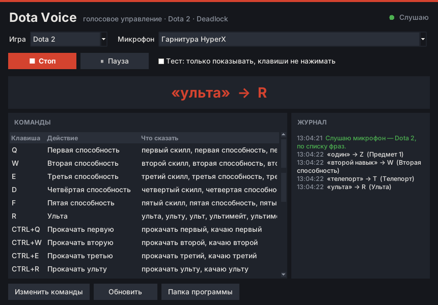

# Dota Voice 🎤

Весёлое мини-приложение: управляешь героем в **Dota 2** и **Deadlock** голосом.



### Dota 2

| Говоришь | Нажимается |
|---|---|
| «первый скилл», «второй скилл», «третий скилл» | `Q`, `W`, `E` |
| «четвертый скилл», «пятый скилл» | `D`, `F` |
| «ульта» | `R` |
| «один» … «шесть» (или «первый предмет» …) | `Z` `X` `C` `V` `B` `N` |
| «телепорт» | `T` |
| «прокачать первый» … «прокачать ульту» | `Ctrl+Q` … `Ctrl+R` |
| «атака», «стоп», «держать», «герой» | `A`, `S`, `H`, `F1` |

### Deadlock

| Говоришь | Нажимается |
|---|---|
| «первый скилл», «второй скилл», «третий скилл» | `1`, `2`, `3` |
| «ульта» (или «четвертый скилл») | `4` |
| «один» … «четыре» (или «первый предмет» …) | `Z` `X` `C` `V` |
| «удар» | `Q` (ближний удар) |
| «парирование», «блок» | `F` |
| «перезарядка» | `R` |
| «прыжок» | `Space` |

В обеих играх: **«голос пауза» / «голос продолжить»** — временно выключить / включить голосовые команды.

Распознавание речи работает **офлайн** (модель [Vosk](https://alphacephei.com/vosk/) для русского языка, ~45 МБ):
голос никуда не отправляется.

## Почему это не чит

Программа устроена так, чтобы не давать преимущества и не трогать игру:

- **Не лезет в игру.** Не читает и не пишет память процесса игры, ничего не внедряет (никаких инжектов и DLL),
  не меняет файлы игры, не перехватывает сетевой трафик и не смотрит на экран.
- **Только обычные нажатия клавиш** через стандартную функцию Windows `SendInput` — тот же механизм,
  что у экранной клавиатуры и программ для людей с ограниченными возможностями. Для игры это неотличимо
  от того, что вы сами нажали клавишу.
- **Одна фраза = одно нажатие.** Макросов, комбо и последовательностей нет и быть не может: в профиле
  у команды ровно одна клавиша (максимум с `Ctrl/Shift/Alt`, как обычная комбинация), список клавиш программа
  отклонит при загрузке. Удержания клавиш тоже нет.
- **Никакой автоматики.** Программа ничего не делает сама: не реагирует на события в игре, не прожимает
  предметы «по таймингу», не целится. Всё только по вашей команде голосом.
- **Голос медленнее пальцев.** Между концом фразы и нажатием проходит около полсекунды — это заведомо медленнее клавиатуры.
- По умолчанию клавиши нажимаются **только когда окно игры активно**, чтобы случайно не «напечатать» в чат
  Discord или браузер.

Честно: у Valve нет официального «белого списка» программ, поэтому стопроцентной гарантии не может дать никто.
Но VAC и правила Steam направлены против программ, которые вмешиваются в игру или автоматизируют действия
(скрипты, макросы, чтение памяти), — эта программа не делает ни того, ни другого. Не добавляйте в неё
последовательности нажатий и автоматические действия — тогда это перестанет быть просто «голосовой клавиатурой».

## Установка (Windows) — готовое приложение

1. Откройте вкладку **Actions** этого репозитория → последний успешный запуск **Build Windows app** →
   внизу в **Artifacts** скачайте **DotaVoice-windows** (нужно войти в GitHub).
2. Распакуйте архив в любую папку (например, `C:\Games\DotaVoice`). Модель распознавания уже внутри.
3. Запустите **`DotaVoice.exe`**.

Windows может показать «Windows защитил ваш компьютер» — это из-за того, что программа не подписана.
Нажмите «Подробнее» → «Выполнить в любом случае».

## Как пользоваться

1. Выберите **игру** (Dota 2 или Deadlock) и **микрофон**.
2. Включите галочку **«Тест»** и нажмите **«Старт»** — поговорите и посмотрите в журнале, что программа слышит.
   В тестовом режиме клавиши не нажимаются.
3. Снимите галочку, зайдите в игру и играйте голосом. Большая надпись в окне показывает последнюю команду.
4. **«Пауза»** (или фраза «голос пауза») — временно перестать реагировать на голос.

Игру и микрофон можно переключать на ходу. Программа запоминает выбор до следующего запуска.

## Настройка команд

Кнопка **«Изменить команды»** открывает профиль текущей игры (`profiles/dota2.toml` или `profiles/deadlock.toml`)
в Блокноте. После сохранения нажмите **«Обновить»**.

```toml
[[command]]
name = "Ульта"
key = "r"
phrases = ["ульта", "ульту", "ульт", "ультимейт"]
```

- `key` — клавиша из настроек игры. Если вы меняли горячие клавиши в игре, поменяйте их и здесь.
- `phrases` — какие фразы запускают команду. Можно добавлять свои синонимы.
- Можно добавить свою игру: скопируйте профиль, поменяйте `[game]` (`name` и `window_title` — заголовок окна игры)
  и команды.

Общие настройки — в `settings.toml`: время удержания клавиши, проверка активного окна, папка модели.

При старте программа проверяет, знает ли модель все слова. Сленг вроде «скилл» маленькая модель может не знать —
тогда в журнале будет написано, какие слова не сработают, а в таблице команд останутся только рабочие фразы.
Поэтому у каждой способности есть запасные варианты («первая способность», «первый навык»).

Советы:
- Говорите коротко и чётко, после фразы — короткая пауза.
- Если программа слышит звуки игры, используйте наушники.
- Dota 2: для способностей с выбором цели скажите «первый скилл» и кликните по цели (или включите быстрое применение).
- Deadlock: «удар» — это лёгкий ближний удар (удержания для сильного удара нет).

## Запуск из исходников

Нужен [Python 3.11+](https://www.python.org/downloads/) (при установке отметьте «Add python.exe to PATH»).

- `install.bat` — поставить библиотеки и скачать модель;
- `start.bat` — открыть окно программы;
- `build_exe.bat` — собрать `dist\DotaVoice\DotaVoice.exe` самому.

Консольный режим и Linux/macOS:

```bash
pip install -r requirements.txt
```

```bash
python3 -m dota_voice --download-model
```

```bash
python3 -m dota_voice --console --game deadlock --dry-run
```

`python3 -m dota_voice --check` проверяет установку и показывает, какие слова из профилей неизвестны модели.
На Linux нажатия отправляются через `pynput` (нужна сессия X11), проверка активного окна там не работает.

## Для разработчиков

```
app.py           — точка входа для сборки .exe
dota_voice/
  __main__.py    — аргументы командной строки, консольный режим, --check
  gui.py         — окно программы (tkinter)
  engine.py      — цикл «микрофон → фраза → нажатие», события для окна и консоли
  config.py      — загрузка settings.toml и профилей игр
  paths.py       — где лежат файлы (исходники или рядом с .exe)
  recognizer.py  — микрофон + Vosk, проверка словаря, загрузка модели
  matcher.py     — разбор распознанного текста на команды
  keys.py        — отправка нажатий (SendInput на Windows, pynput на других ОС)
profiles/        — профили игр
tests/           — тесты (python -m unittest discover -s tests -t .)
.github/workflows/build.yml — сборка DotaVoice.exe в GitHub Actions
```
